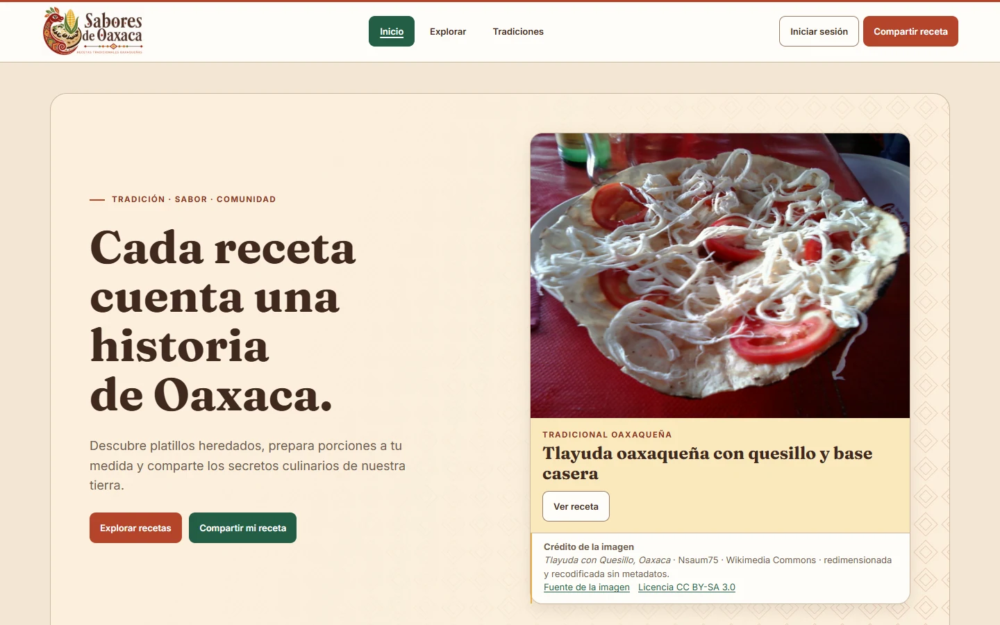
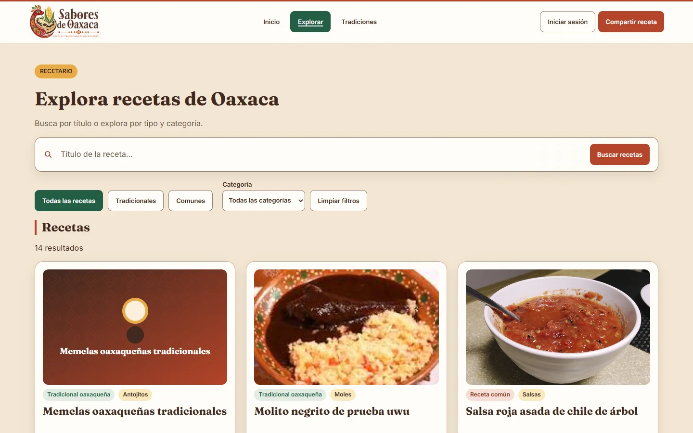
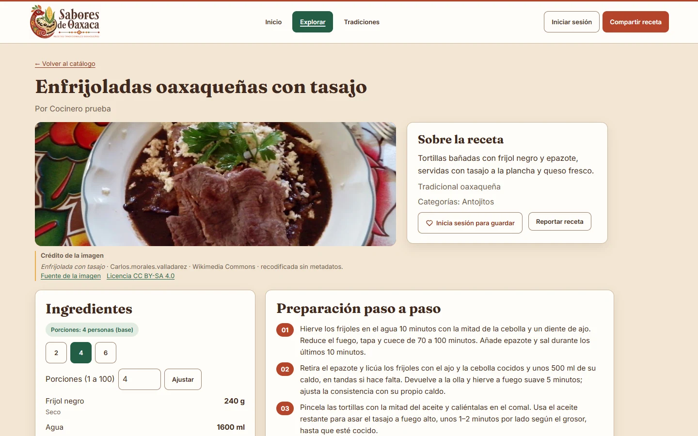
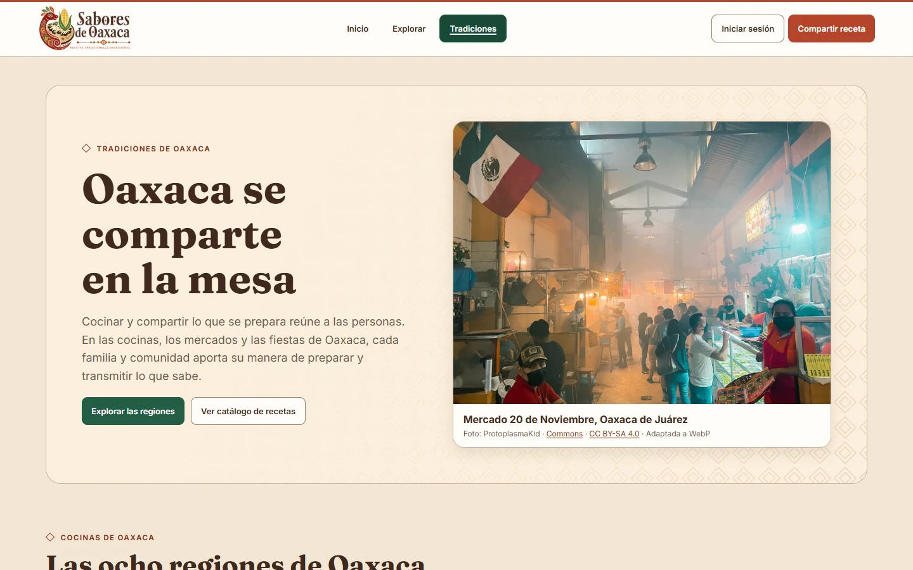
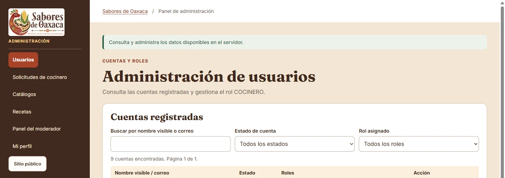
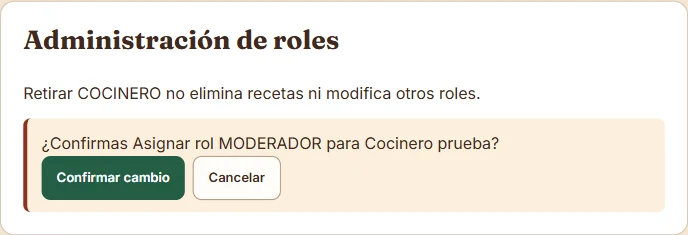
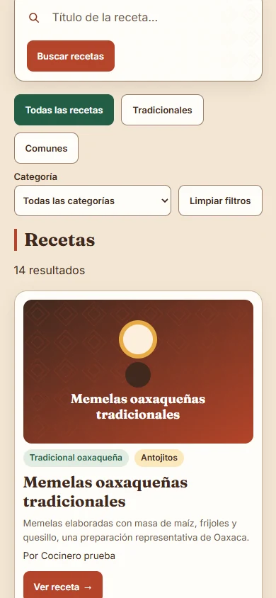
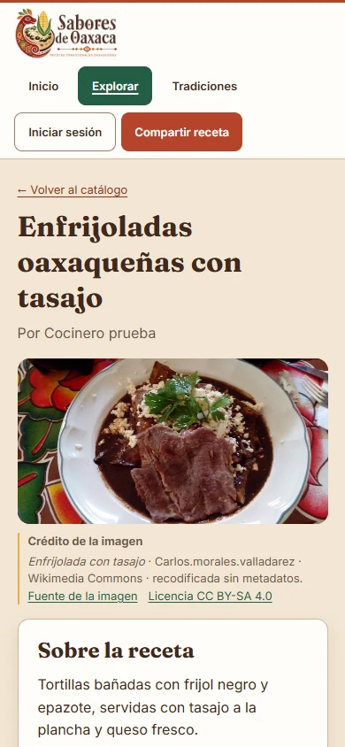
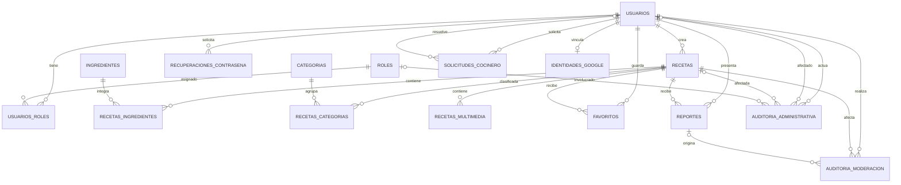

# Sabores de Oaxaca

Aplicación web para descubrir, compartir y moderar recetas oaxaqueñas. Incluye catálogo público, detalle con ajuste de porciones, registro e inicio de sesión, favoritos, edición y envío de recetas, moderación, reportes y panel de administración de usuarios, catálogos y recetas. La recuperación de contraseña y las alertas SMS requieren configuración explícita; consultar [limitaciones](#limitaciones-y-pendientes).

## Demostración visual

Capturas de la versión desplegada en [saboresdeoaxaca.food](https://saboresdeoaxaca.food/). La [guía de demostración](docs/DEMONSTRACION.md) reúne los recorridos completos y las comprobaciones pendientes.

### Inicio

El logotipo oficial y la navegación dan acceso al catálogo y a Tradiciones. La portada presenta el proyecto con una receta oaxaqueña; más abajo se muestran recetas destacadas y un acceso a las regiones.



### Explorar recetas

El catálogo centrado muestra fotografías de las recetas publicadas. Se puede buscar por título, filtrar por tipo o categoría y avanzar entre páginas.



### Detalle de receta

La ficha muestra la fotografía, la descripción y el autor. Más abajo aparecen los ingredientes con sus cantidades, un selector que recalcula las porciones y la preparación paso a paso.



### Tradiciones

Un recorrido por la gastronomía oaxaqueña que presenta sus ocho regiones con fotografías y descripciones.



### Autenticación y áreas de trabajo

La guía muestra los [formularios de inicio de sesión, registro y recuperación](docs/DEMONSTRACION.md#autenticación), los [favoritos y la revisión de reportes con sesión iniciada](docs/DEMONSTRACION.md#usuario-registrado), las [recetas propias y el editor de cocinero](docs/DEMONSTRACION.md#cocinero) y la [cola editorial y el filtro de reportes de moderación](docs/DEMONSTRACION.md#moderador).

### Administrador

El panel reúne **Usuarios**, **Solicitudes de cocinero**, **Catálogos** y **Recetas**. En el [recorrido administrativo](docs/DEMONSTRACION.md#administrador) se muestran las búsquedas y filtros en producción, los controles de gestión, el acceso denegado sin `ADMIN` y las vistas móviles. Las confirmaciones se abrieron y se cancelaron antes de enviar cambios.





### Diseño responsivo

En pantallas estrechas, el catálogo reorganiza las tarjetas en una columna y la ficha apila la fotografía y la descripción. Las siguientes vistas son del mismo catálogo y la misma receta que se muestran arriba en escritorio.

| Catálogo en móvil | Detalle de receta en móvil |
| :---: | :---: |
|  |  |

## Tecnologías y arquitectura

- **Frontend:** React 19 y Vite, con cliente HTTP para la API.
- **Backend:** Java 17, Spring Boot 4.1.2, Spring Security, JWT, BCrypt, Bean Validation y Spring Data JPA. Controladores, DTOs, servicios transaccionales y repositorios separan las responsabilidades.
- **Datos:** MySQL 8.0 y migraciones Flyway V1–V9; archivos multimedia externos referenciados mediante HTTPS.
- **Despliegue en VPS:** frontend y API detrás de Nginx con HTTPS en `https://saboresdeoaxaca.food`. El equipo comprobó la API pública y el frontend desplegados; la validación debe repetirse después de cada actualización. Los archivos subidos usan almacenamiento persistente independiente del repositorio y de `dist`.

La URL base de la API es `https://saboresdeoaxaca.food/api/v1`. Las rutas públicas permiten consultar recetas publicadas visibles, categorías e ingredientes; búsqueda, filtros y paginación del catálogo se procesan en el servidor. Los formularios muestran validaciones, hay rutas protegidas, navegación y confirmaciones para acciones relevantes. La autorización se comprueba en el servidor; el frontend no sustituye sus reglas. Los contratos específicos están en [`backend/docs/`](backend/docs/).

## Modelo entidad-relación

Las tablas intermedias `USUARIOS_ROLES`, `RECETAS_INGREDIENTES`, `RECETAS_CATEGORIAS` y `FAVORITOS` implementan relaciones N:M. Las líneas reflejan claves foráneas de V1–V9; atributos y restricciones se detallan en el [diagrama y modelo](backend/docs/DIAGRAMA_ER.md).



## Roles

Los roles no son jerárquicos: una cuenta puede tener varios.

| Rol | Funciones de backend |
| --- | --- |
| `USUARIO` | Autenticarse, gestionar favoritos y reportar recetas visibles ajenas. |
| `COCINERO` | Crear y editar sus borradores o rechazadas, enviar a revisión y subir multimedia. |
| `MODERADOR` | Revisar recetas y resolver reportes, sin decidir sobre sus propios reportes o recetas. |
| `ADMIN` | Consultar y filtrar cuentas, desactivar o reactivar cuentas, asignar o retirar `COCINERO` y `MODERADOR`, resolver solicitudes de `COCINERO`, consultar catálogos de solo lectura y gestionar la baja lógica y restauración de recetas. También puede moderar con las mismas restricciones de conflicto de interés. |

El registro público no concede privilegios administrativos. La edición y las decisiones requieren versiones vigentes cuando el contrato lo indica. Ver [recetas propias](backend/docs/RECETAS_COCINERO_API.md), [moderación](backend/docs/MODERACION_API.md), [reportes](backend/docs/REPORTES_API.md) y [administración](backend/docs/ADMIN_USUARIOS_API.md).

La API impide la autodesactivación y protege al último administrador activo. Desactivar una cuenta revoca sus sesiones; un cambio efectivo de `COCINERO` o `MODERADOR` invalida sus JWT y conserva los demás roles. Las bajas y restauraciones de recetas requieren justificación y una versión vigente. Ver [solicitudes de cocinero](backend/docs/SOLICITUDES_COCINERO_API.md) y [administración de recetas](backend/docs/ADMIN_RECETAS_API.md).

### Acceso de evaluación

En un entorno aislado autorizado, registrar cuentas de prueba separadas con credenciales aleatorias; un administrador existente y autorizado puede asignar `COCINERO` y `MODERADOR` desde la gestión de cuentas o resolver una solicitud de cocinero. El registro no crea `ADMIN` y el panel no concede ese rol: la preparación inicial de un administrador debe hacerla el responsable autorizado conforme al procedimiento seguro del entorno, fuera de Git. Entregar al evaluador el acceso temporal por un canal privado seguro, nunca en capturas, Bruno ni el repositorio; coordinar su desactivación posterior. No se acredita aquí que una cuenta de evaluación ya exista.

## Requisitos y ejecución local

Se requieren JDK 17, MySQL Community 8.0.16–8.0.x, Node.js y npm compatibles con Vite 8 y React 19, y Git. El backend incluye Maven Wrapper. Crear una base **de desarrollo** vacía y una cuenta MySQL limitada a esa base. No utilizar datos de producción para pruebas destructivas.

En la terminal del backend, configurar mediante variables de entorno `DB_URL`, `DB_USERNAME`, `DB_PASSWORD` y `JWT_SECRET_BASE64` (clave aleatoria Base64 de al menos 32 bytes). No guardar secretos reales en Git. Para el perfil `dev`:

```sh
cd backend
./mvnw spring-boot:run -Dspring-boot.run.profiles=dev
```

En Windows usar `mvnw.cmd`. El perfil `dev` habilita Flyway, aplica las migraciones pendientes y valida el esquema con Hibernate; no hace `clean` ni actualiza tablas por Hibernate. Ante una base existente sin historial Flyway, revisar y respaldar antes de intervenir; no aplicar baseline o repair automáticamente. El perfil `bootstrap` solo sirve para comprobar el arranque sin MySQL y no representa una aplicación funcional. Ver [configuración backend](backend/README.md).

Para el frontend, en otra terminal:

```sh
cd frontend
npm ci
npm run dev
```

Consultar [`frontend/README.md`](frontend/README.md) para las variables y modos del cliente. Para permitir el navegador local, configurar `CORS_ALLOWED_ORIGINS` con orígenes exactos cuando no se use el valor de `dev`; no incluir comodines ni secretos.

## Compilación y pruebas

```sh
cd backend
./mvnw clean verify
```

```sh
cd frontend
npm test
npm run build
```

Las pruebas MySQL son optativas y necesitan un esquema aislado nuevo, vacío y una cuenta de permisos limitados; no se activan con el comando habitual. Leer [`backend/src/test/PRUEBAS_MYSQL.md`](backend/src/test/PRUEBAS_MYSQL.md) antes de ejecutarlas. Los detalles de esquema, datos ficticios y respaldo están en [`database/README.md`](database/README.md); el diagrama [ER](backend/docs/DIAGRAMA_ER.md) describe las relaciones principales.

En el VPS se aprobaron 217 pruebas frontend antes del despliegue del PR #71. La ejecución local posterior de `npm test`, con Node 24.15.0, no concluyó satisfactoriamente: 140 pruebas aprobaron y 8 archivos de prueba fallaron al cargar por dependencias no instaladas (`react`, `react-router` y `@vitejs/plugin-react`); terminó con código 1. Estas pruebas locales, muchas con HTTP simulado, no verifican producción. Falta instalar dependencias y repetirlas; no se ejecutaron aquí la compilación ni las pruebas backend o MySQL. El equipo comunicó pruebas aisladas del flujo administrativo descritas en el [checklist](CHECKLIST_ENTREGA.md); las capturas documentan su propio alcance.

## Datos de producción y requisito de entrega

La asignación oficial exige un mínimo de 10–15 registros por tabla principal. Los datos de producción verificados son **8 categorías, 40 ingredientes, 19 recetas (18 publicadas) y 9 usuarios activos**. Las asignaciones de roles son `ADMIN`: 2, `COCINERO`: 6, `MODERADOR`: 1 y `USUARIO`: 9; una cuenta puede tener varios roles, por lo que estas cifras no se suman como usuarios distintos. Categorías y usuarios activos están por debajo de 10; faltan conteos para acreditar las demás tablas principales. El script [propuesto](database/seed_catalogos_entrega.sql) contiene cinco categorías adicionales, pero **no se ha ejecutado**: no acredita 13 categorías en producción. Ver [base de datos](database/README.md).

## Bruno

Importar la carpeta [`bruno/`](bruno/) con **Open Collection**, seleccionar el entorno y proporcionar localmente los ID, JWT y credenciales de cuentas de prueba. La colección incluye comprobaciones positivas y negativas; algunas modifican datos o revocan sesiones. Ejecutarlas individualmente y solo en un entorno autorizado. No versionar tokens, contraseñas ni respuestas sensibles. Consultar [`bruno/README.md`](bruno/README.md) para precondiciones y secuencia.

## Despliegue y HTTPS

El entorno de despliegue del equipo usa `https://saboresdeoaxaca.food` (frontend y API bajo `/api/v1`) y `https://media.saboresdeoaxaca.food` para multimedia. Se comprobaron HTTPS, el servicio Spring Boot y una respuesta pública correcta del catálogo; la comprobación no sustituye las pruebas integrales de aceptación, correo o SMS. Los ajustes de Nginx, TLS, CORS, base y secretos se gestionan fuera del repositorio; **no** usar el perfil `bootstrap` en producción. La subida requiere `APP_UPLOAD_DIR` y `APP_UPLOAD_PUBLIC_ORIGIN`, volumen persistente y publicación controlada por Nginx: ver [multimedia](backend/docs/MULTIMEDIA_UPLOADS_API.md). Existe un respaldo SQL privado del VPS; falta acreditar una restauración aislada y respaldar también los archivos multimedia.

## Limitaciones y pendientes

- La recuperación está deshabilitada por defecto. Requiere configuración explícita y un transporte SMTP verificado; el VPS de DigitalOcean tiene salida SMTP restringida. No se garantiza entrega a proveedores externos. Ver [recuperación](backend/docs/RECUPERACION_CONTRASENA_API.md).
- El aviso SMS por reporte utiliza Infobip, es opcional y está deshabilitado por defecto; su configuración y entrega efectiva dependen del entorno. No existe un endpoint público para enviar SMS. La opción de inicio con Google aparece en el formulario; su flujo no se verificó en esta demostración. Ver [configuración SMS](backend/docs/SMS_REPORTES_INFOBIP.md).
- JavaMailSender admite SMTP configurado, pero no está acreditado correo real mediante Postfix ni entrega externa. WhatsApp no está implementado; ambos requisitos de la rúbrica quedan sin acreditar o incumplidos, respectivamente. La entrega SMS tampoco está acreditada.
- El CRUD administrativo es parcial: catálogos de solo lectura, cuentas sin alta o edición general desde el panel y recetas con consulta, baja lógica y restauración, no CRUD general. Ver los contratos administrativos.
- No hay respaldo SQL completo importable incluido en el repositorio: el seed no lo sustituye. [Instrucciones para generar un ejemplo seguro](database/README.md#respaldo-de-ejemplo-importable-para-entrega).
- Catálogos y recetas del panel administrativo consultan la API. Se retiró el directorio público de autores de demostración; los autores reales de las recetas no se modificaron.
- Las URL multimedia de los datos ficticios no son imágenes reales. El script demo prepara 13 recetas y 27 ingredientes, sujeto a sus precondiciones; no sustituye la comprobación de los mínimos oficiales en cada tabla principal.
- El acceso seguro de evaluación sigue pendiente de preparación y entrega privada; no se acredita que existan cuentas de evaluación.
- Sigue pendiente validar la recuperación de un respaldo MySQL en un esquema aislado, respaldar multimedia, comprobar controles contra abuso y repetir pruebas funcionales después de cada despliegue. No confundir «dump creado» con «restauración comprobada».

Consultar el [checklist de entrega](CHECKLIST_ENTREGA.md) y el [índice REST](backend/docs/API_REST.md) para los contratos y verificaciones pendientes.

## Diseño, código y colaboración

- [Prototipo Figma](https://www.figma.com/design/x3Ny7TxoDdnTldzxbUAz6u/Sabores-de-Oaxaca-%C2%B7-Proyecto-Final-%C2%B7-Prototipo-Navegable?node-id=0-1)
- [Repositorio GitHub](https://github.com/aleksardio/sabores-de-oaxaca)
- [GitHub Projects público: Sabores de Oaxaca - Proyecto Final](https://github.com/users/aleksardio/projects/2) — tablero de 17 Issues y 9 PR fusionados (estado revisado el 25 de noviembre de 2026, UTC).
- [Issues y pendientes](https://github.com/aleksardio/sabores-de-oaxaca/issues) — estado real y responsables de implementación.

Aleks participa principalmente en backend, seguridad y despliegue; Alexis, en frontend y diseño. Trabajar en ramas por funcionalidad, ejecutar las pruebas aplicables, abrir Pull Requests y revisar contratos y cambios antes de integrarlos. No incluir credenciales ni información personal en commits o capturas.

La identidad visual usa el logotipo mostrado en la portada. La paleta de [`global.css`](frontend/src/styles/global.css) combina tierra `#b44429`, verde `#235d46` y dorado `#e8ac45`, asociados a ingredientes y tradiciones culinarias, con crema `#f3e6d3` y superficies `#fffdf8` que aportan calidez; el texto oscuro `#40281f` favorece la legibilidad. La autoría original del logo y la navegabilidad pública de Figma requieren evidencia adicional si la rúbrica las exige.
