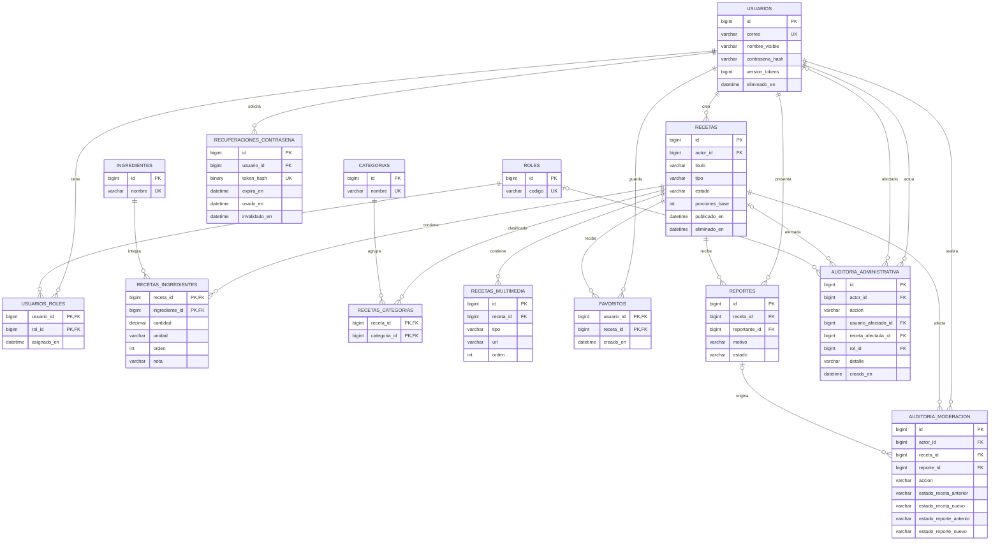

# Diagrama entidad-relación

Esquema conceptual: las restricciones completas, tipos exactos, índices y dominios están en [MODELO_DATOS.md](MODELO_DATOS.md). `recetas.tipo` es `VARCHAR(30)`; `recetas_ingredientes.cantidad` es `DECIMAL(12,3)` nullable exclusivamente para `AL_GUSTO`, y `nota` es opcional. Las patas indican la opcionalidad de cada relación; no implican borrado en cascada. Las entidades de unión tienen PK compuestas. En auditoría administrativa las FK de recurso son alternativas según el CHECK; `rol_id` solo acompaña cambios de rol.

