# Demostración de Sabores de Oaxaca

[Volver al README](../README.md#demostración-visual) · [Abrir el sitio en producción](https://saboresdeoaxaca.food/)

Evidencias de la interfaz de producción capturadas el 27 de noviembre de 2026 con Chrome y Playwright. Las vistas de escritorio usan una ventana de 1440 × 900 px y las de móvil, una de 390 × 844 px. Algunas imágenes se centran en un componente para mantener legibles sus controles y su contenido. Las capturas están en WebP.

## Inicio

La [portada de escritorio](capturas/inicio/presentacion-y-navegacion.webp) muestra el logotipo oficial, la navegación principal y la presentación del recetario.

Las **recetas destacadas** enlazan a fichas publicadas.

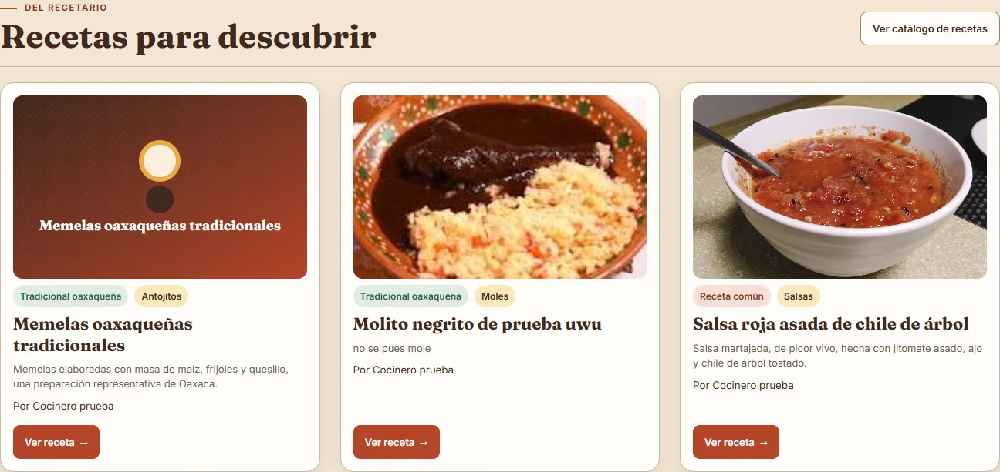

La sección de **regiones** enlaza directamente a las fichas regionales de Tradiciones.

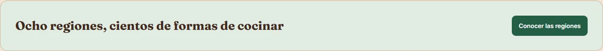

## Explorar recetas

El [catálogo de escritorio](capturas/explorar/catalogo-centrado.webp) muestra el diseño centrado y las fotografías disponibles. Las recetas sin fotografía tienen una ilustración de respaldo.

### Búsqueda por título

La búsqueda de **Enfrijoladas** devuelve la ficha de enfrijoladas oaxaqueñas con tasajo.

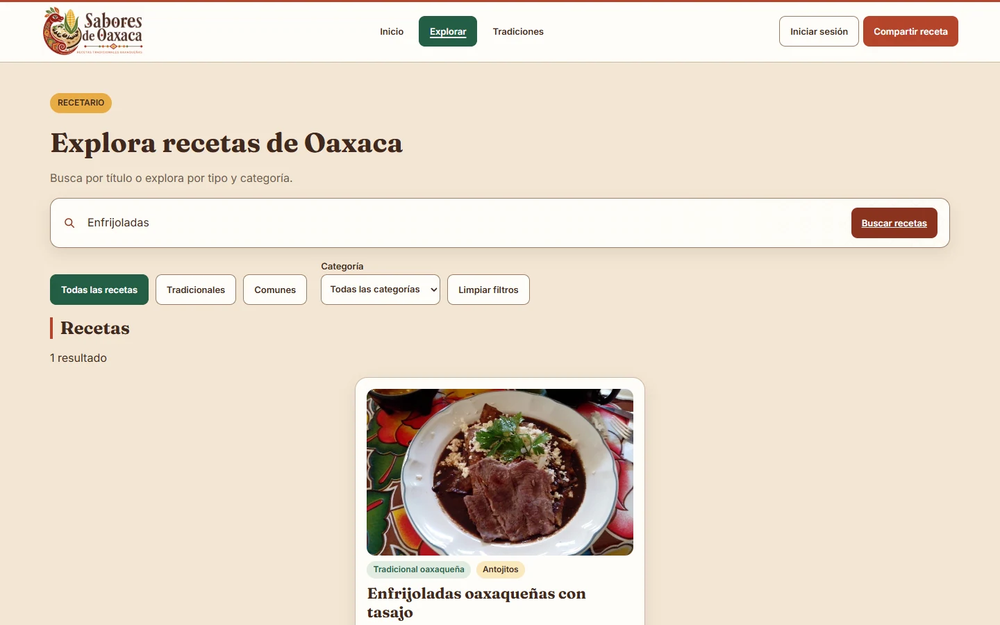

### Recetas tradicionales oaxaqueñas

La opción **Tradicionales** limita los resultados a ese tipo de receta.

### Categoría

El selector de categoría muestra solo recetas de **Antojitos** en este ejemplo.

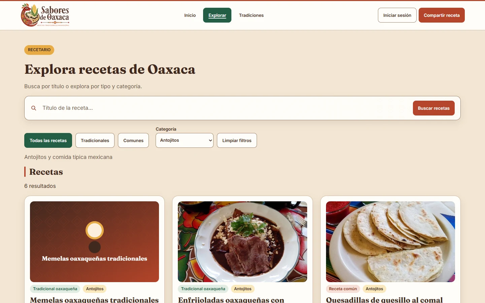

### Paginación

El catálogo mostraba **14 recetas en 3 páginas**. Se comprobó que **Siguiente** abre un grupo distinto de fichas y **Anterior** vuelve a la primera página.

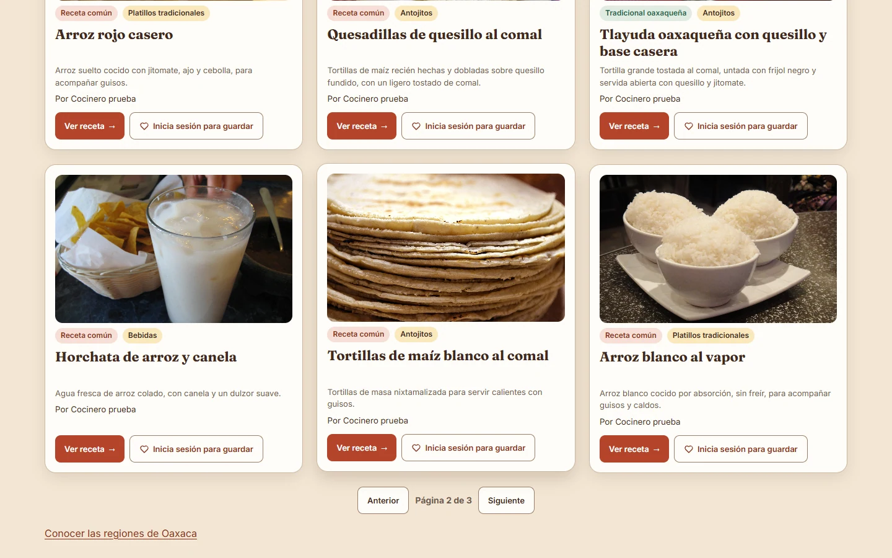

## Detalle de receta

La [ficha de enfrijoladas](capturas/receta/ficha-de-enfrijoladas.webp) muestra la fotografía publicada, su descripción y la atribución a la cuenta de prueba autora.

La receta indica las cantidades para **4 personas** y presenta la preparación como una secuencia de pasos.

Al cambiar a **2 personas**, las cantidades se recalculan. Volver a **4 personas** restaura los valores originales.

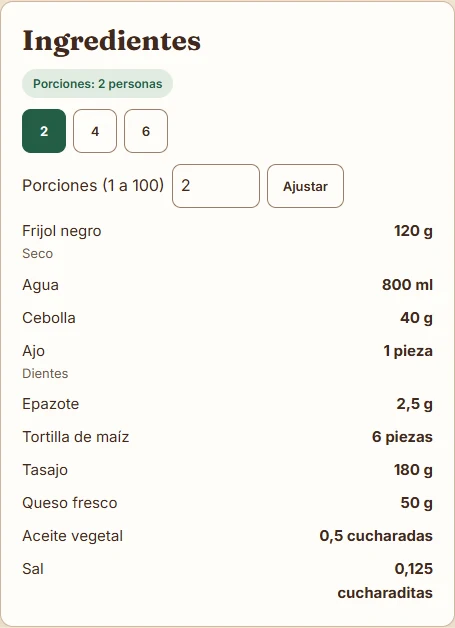

## Tradiciones

La [presentación de Tradiciones](capturas/tradiciones/presentacion-gastronomica.webp) introduce la gastronomía de Oaxaca. La galería reúne las ocho regiones: Cañada, Costa, Istmo, Mixteca, Papaloapan, Sierra Norte, Sierra Sur y Valles Centrales. Cada tarjeta incluye una fotografía, su crédito y una descripción.

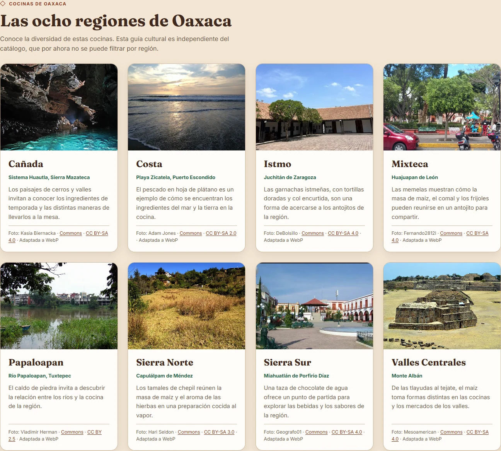

## Autenticación

**Inicio de sesión.** El formulario vacío muestra el acceso con correo y contraseña, y los enlaces de registro y recuperación.

**Registro.** El formulario solicita nombre visible, correo, contraseña y confirmación.

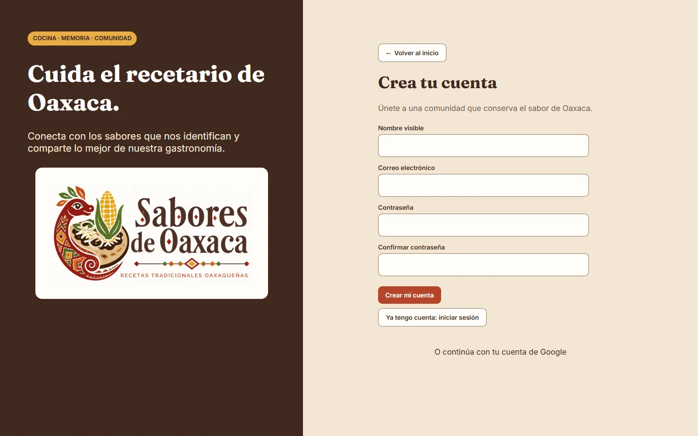

**Recuperación de contraseña.** Se comprobó el formulario. No se solicitó ni se verificó la entrega de un correo.

## Áreas autenticadas

### Usuario registrado

**Favoritos con sesión iniciada.** Tras iniciar sesión manualmente con la cuenta de prueba, se guardaron las enfrijoladas. El botón cambió a **Quitar de favoritos** y la receta apareció en **Mis recetas favoritas**. Al terminar se retiró el favorito temporal y se comprobó que el listado volvió a su estado inicial.

**Reportar una receta.** En una ficha de otra autoría, el formulario pide un motivo y permite revisar el envío. La vista previa ofrece confirmar, volver a editar o cancelar. Se canceló el borrador después de capturar la vista previa: no se envió ningún reporte.

| Formulario | Confirmación previa |
| :---: | :---: |
|  |  |

### Cocinero

**Mis recetas.** La cuenta de prueba muestra el listado propio, los totales por estado editorial y los controles de búsqueda y filtro. En la página consultada, las recetas visibles estaban publicadas.

**Crear receta.** En el editor se seleccionó una categoría y se añadió un ingrediente del catálogo con su cantidad. Estos cambios quedaron en el formulario, sin guardar.

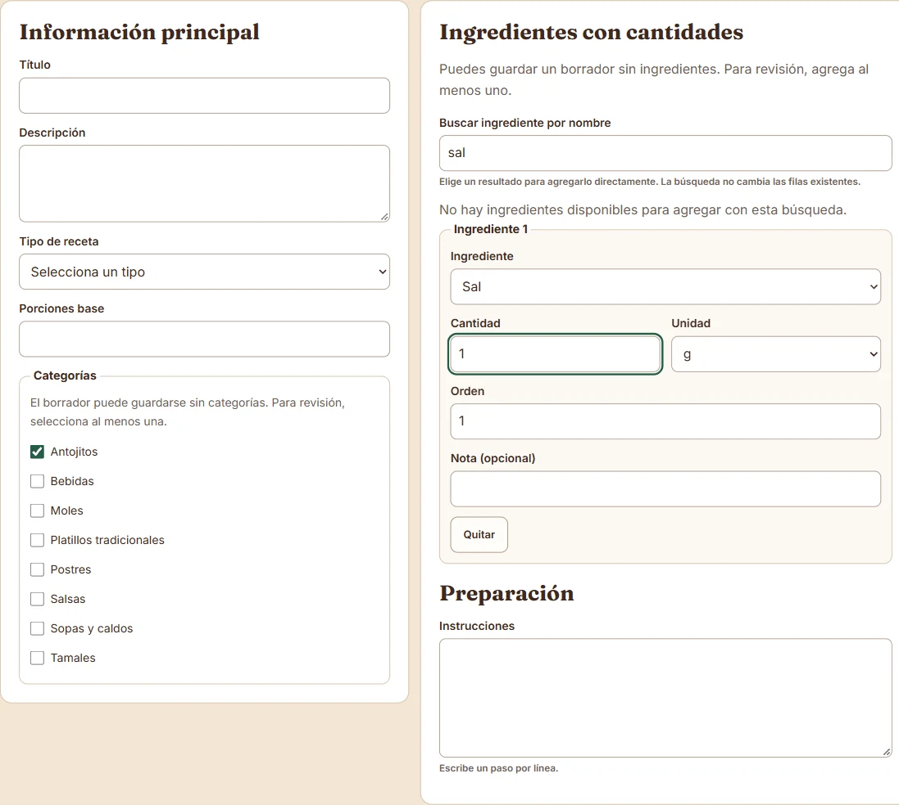

**Multimedia.** El selector admite fotos y videos en los formatos y tamaños indicados. No se subieron archivos.

**Envío a revisión.** El formulario indica que primero hay que guardar un borrador. No había un borrador ni una receta rechazada editable en la página consultada, así que la evidencia llega hasta este requisito.

### Moderador

**Cola de recetas.** El panel muestra el número de pendientes y el filtro por tipo. En el momento de la consulta había **0 recetas pendientes**.

**Reportes.** Se consultó la bandeja y se aplicó el filtro **En revisión**, que devolvió una lista vacía. La captura muestra ese resultado sin exponer nombres ni motivos de los reportes.

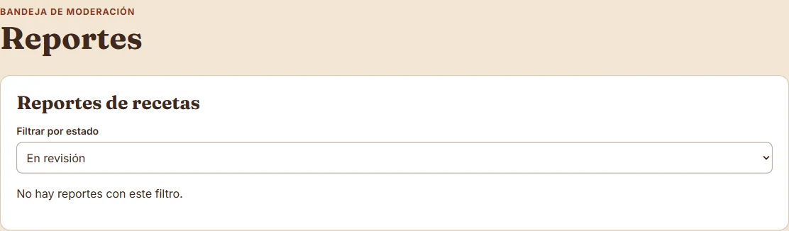

### Administrador

El recorrido se realizó en producción con Chrome y Playwright, después de verificar que la interfaz mostraba los controles nuevos y que la API reconocía las rutas de gestión de cuentas y del rol `MODERADOR`. Las sesiones de prueba se iniciaron manualmente. Las capturas del área administrativa excluyen correos e identificadores de cuentas.

#### Panel y navegación

El menú conecta **Usuarios**, **Solicitudes de cocinero**, **Catálogos** y **Recetas**. La pantalla inicial presenta el listado y los filtros de cuentas.

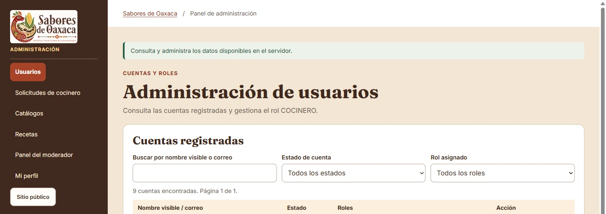

#### Usuarios y filtros

La búsqueda por nombre permite localizar una cuenta de prueba. La fila muestra el estado, los roles asignados y el enlace a su detalle; la captura de la fila omite la columna con el correo.

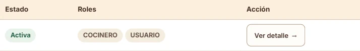

Se comprobó que la búsqueda por nombre puede combinarse con los filtros **COCINERO** y **Activas**. El detalle devuelve los roles actuales; el recorte muestra esa parte de la ficha.

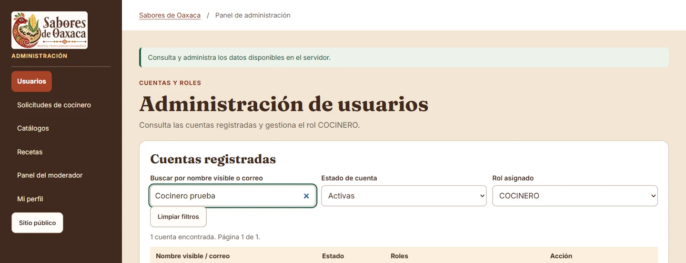

El filtro **Desactivadas** también se comprobó. Las búsquedas realizadas con ese filtro no identificaron una cuenta de prueba inactiva para mostrar el control de reactivación.

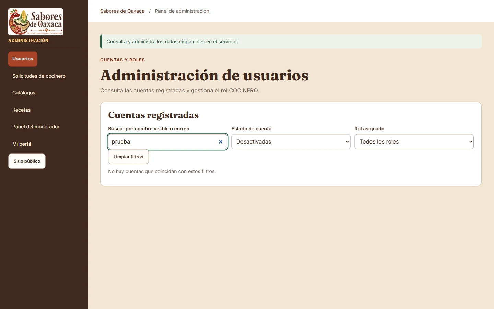

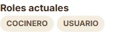

#### Gestión de roles

En las cuentas activas, cada botón cambia según el rol ya asignado. Se observaron las cuatro opciones: **Asignar** y **Retirar** para `COCINERO` y `MODERADOR`. En la cuenta de prueba se abrieron y cancelaron las vistas previas de **Retirar COCINERO** y **Asignar MODERADOR**. Las otras dos opciones se observaron sin abrir una confirmación.

| Retirar COCINERO y asignar MODERADOR | Asignar COCINERO y retirar MODERADOR |
| :---: | :---: |
| 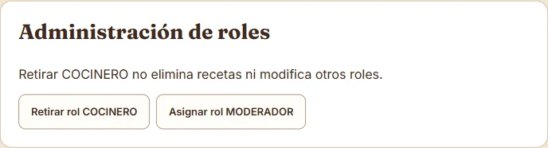 | 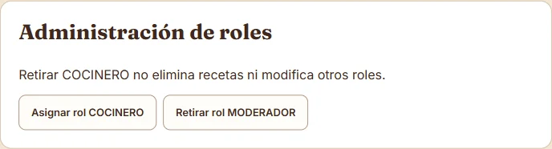 |

| Confirmación previa de retiro | Confirmación previa de asignación |
| :---: | :---: |
| 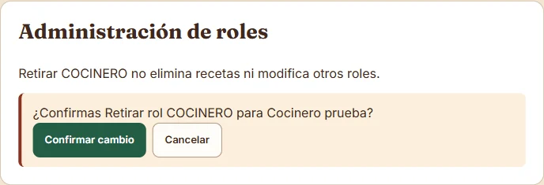 |  |

#### Gestión de cuentas

En el detalle de otra cuenta de prueba activa, **Desactivar cuenta** abrió la confirmación. Se canceló y no se cambió el estado.

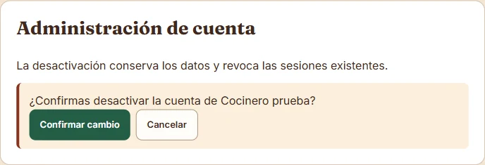

En el detalle de su propia cuenta activa, el administrador ve el aviso de protección y no dispone del control de desactivación.

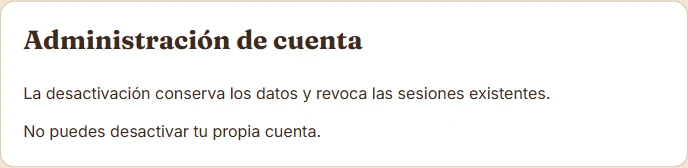

#### Solicitudes de cocinero

La bandeja consultó la API y mostró que no había solicitudes pendientes en la página. Por ello no se muestran controles ni vistas previas de aprobación o rechazo.

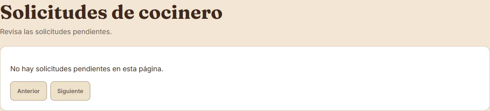

#### Catálogos de solo lectura

La interfaz cargó los listados de categorías e ingredientes de producción. Las dos búsquedas son independientes: **Antojitos** redujo el listado de categorías y **frijol** el de ingredientes. La sección es de solo lectura.

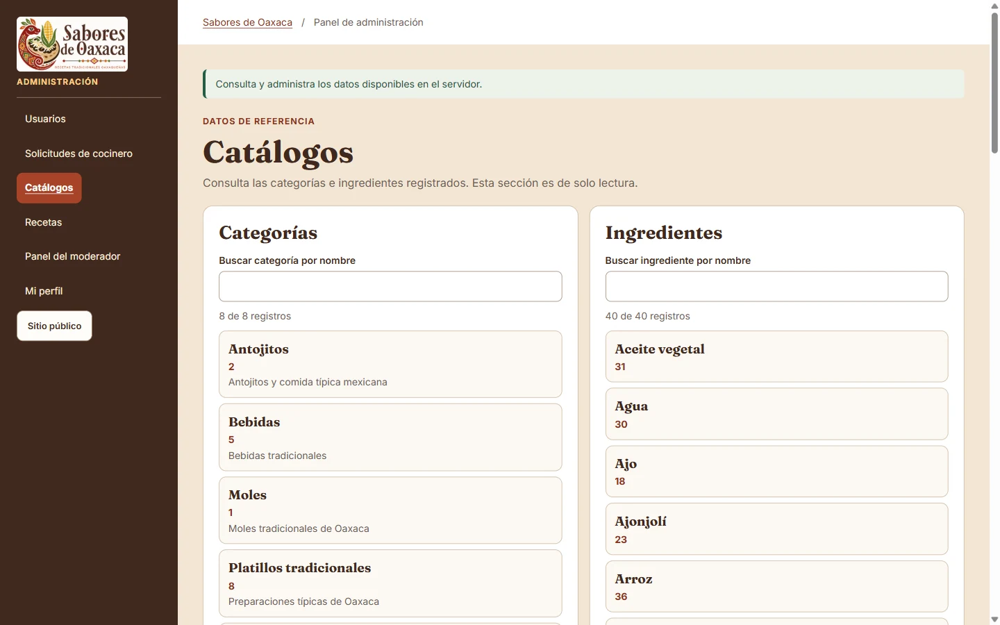

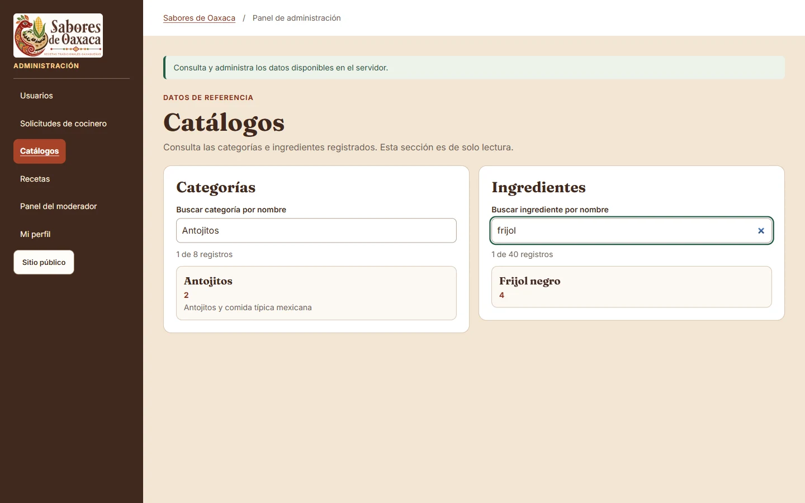

#### Administración de recetas

La API devuelve las recetas registradas con su estado editorial y su baja lógica como campos independientes.

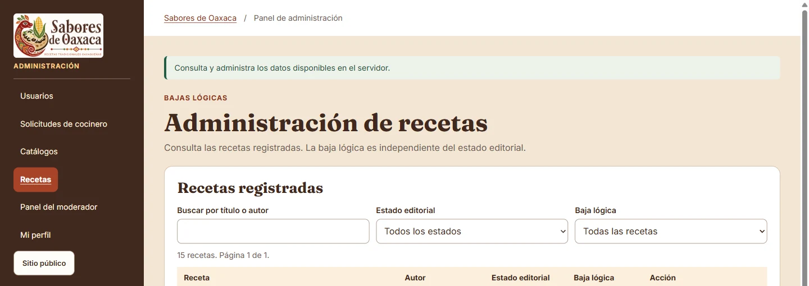

La búsqueda por el título de las **enfrijoladas oaxaqueñas con tasajo** se combinó con los filtros **Publicada** y **Sin baja**. La consulta mostró la ficha correspondiente.

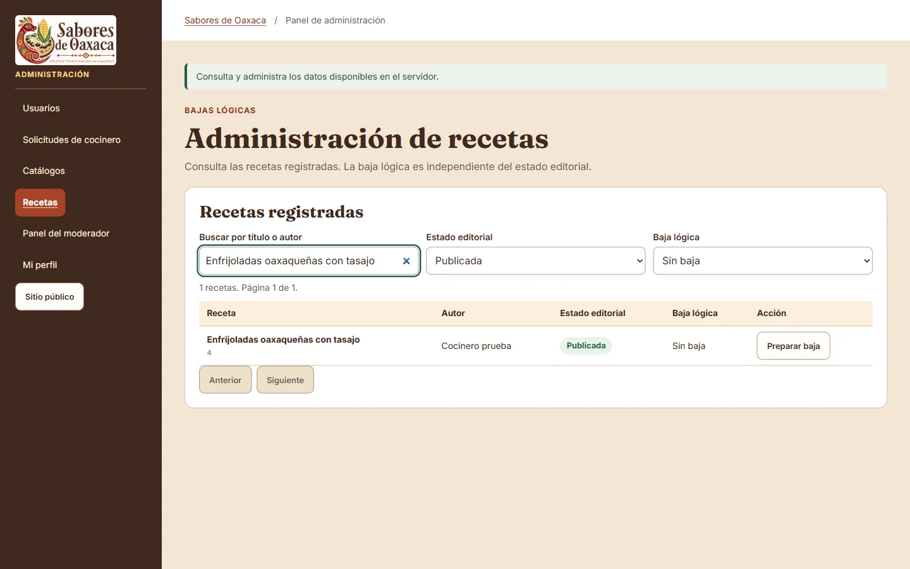

**Preparar baja** abrió un formulario que exige justificación. Se escribió un texto de prueba para verificar que habilitaba el botón de confirmación y se canceló el formulario. El filtro inverso **De baja lógica** se consultó, pero en la página revisada no se identificó una receta de prueba para mostrar el formulario de restauración.

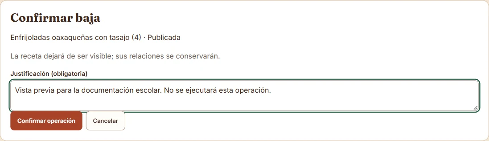

#### Control de acceso

Una cuenta autenticada sin `ADMIN` recibió **Acceso denegado** al abrir el panel. La consulta de usuarios con esa misma sesión recibió HTTP `403`.

#### Diseño responsivo del panel

A 390 px de ancho, el menú distribuye los enlaces en varias filas y el listado de usuarios presenta sus campos en una tarjeta. Los recortes del listado y del detalle dejan fuera los datos de identidad.

| Navegación | Listado de usuarios | Detalle de usuario |
| :---: | :---: | :---: |
| 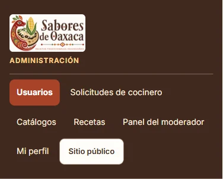 | 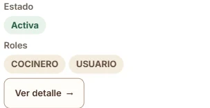 | 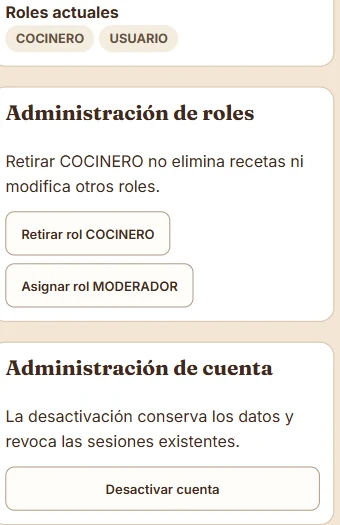 |

#### Alcance de las pruebas administrativas

Las lecturas y el control de acceso se comprobaron en producción. Las confirmaciones previas son pasos de interfaz: se cancelaron y la comprobación de red registró cero peticiones de escritura administrativa. La reactivación, las decisiones sobre solicitudes y la restauración quedaron sin vista previa por falta de datos de prueba adecuados. Para verificar de extremo a extremo las escrituras, la revocación de sesiones, la auditoría y la protección del último administrador activo, se propone una prueba separada con cuentas y recetas ficticias en un entorno aislado.

## Diseño responsivo

En móvil, el contenido se apila para adaptarse al ancho de pantalla. Compárese con el [inicio de escritorio](capturas/inicio/presentacion-y-navegacion.webp), el [catálogo](capturas/explorar/catalogo-centrado.webp) y la [ficha](capturas/receta/ficha-de-enfrijoladas.webp).

| Catálogo | Detalle de receta |
| :---: | :---: |
| 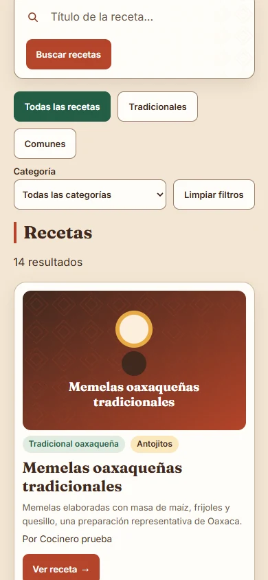 | 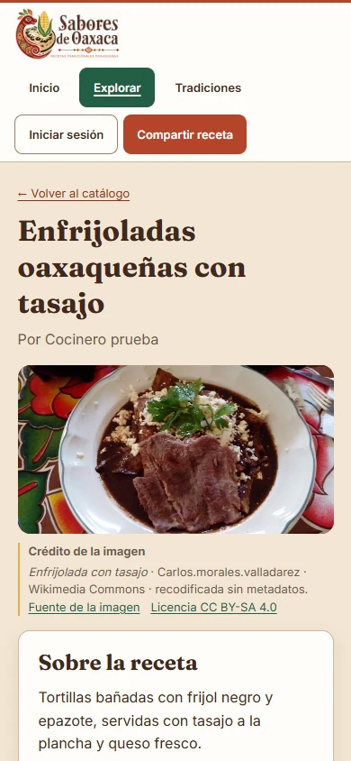 |

**Vista autenticada.** En móvil, la [lista de favoritos de escritorio](capturas/usuario/listado-de-favoritos.webp) ajusta la tarjeta al ancho disponible y mantiene los accesos para abrir o quitar la receta guardada.

## Evidencia pendiente

| Funcionalidad | Estado de la evidencia |
| --- | --- |
| Reproducción de video | Ninguna de las 14 fichas publicadas consultadas contenía un video. |
| Entrega de correo de recuperación | Se comprobó la presencia del formulario. No se solicitó un mensaje. |
| Acción de enviar a revisión | Sin un borrador o una receta rechazada editable en la página consultada. No se creó ni envió una receta. |
| Detalle y opciones de aprobación y rechazo | La cola de moderación estaba vacía. No se tomaron decisiones sobre recetas. |
| Reportes con registros visibles | Se comprobó la bandeja y un filtro sin coincidencias. Se omitieron de la evidencia las filas con datos de reportantes. |
