# Demostración de Sabores de Oaxaca

[Volver al README](../README.md#demostración-visual) · [Abrir el sitio en producción](https://saboresdeoaxaca.food/)

Evidencias de la interfaz de producción capturadas el 27 de noviembre de 2026 con Chrome y Playwright. Las vistas de escritorio usan una ventana de 1440 × 900 px y las de móvil, una de 390 × 844 px. Algunas imágenes se centran en un componente para mantener legibles sus controles y su contenido. Las capturas están en WebP.

## Inicio

La [portada de escritorio](capturas/inicio/presentacion-y-navegacion.webp) muestra el logotipo oficial, la navegación principal y la presentación del recetario.

Las **recetas destacadas** enlazan a fichas publicadas.

La sección de **regiones** enlaza directamente a las fichas regionales de Tradiciones.

## Explorar recetas

El [catálogo de escritorio](capturas/explorar/catalogo-centrado.webp) muestra el diseño centrado y las fotografías disponibles. Las recetas sin fotografía tienen una ilustración de respaldo.

### Búsqueda por título

La búsqueda de **Enfrijoladas** devuelve la ficha de enfrijoladas oaxaqueñas con tasajo.

### Recetas tradicionales oaxaqueñas

La opción **Tradicionales** limita los resultados a ese tipo de receta.

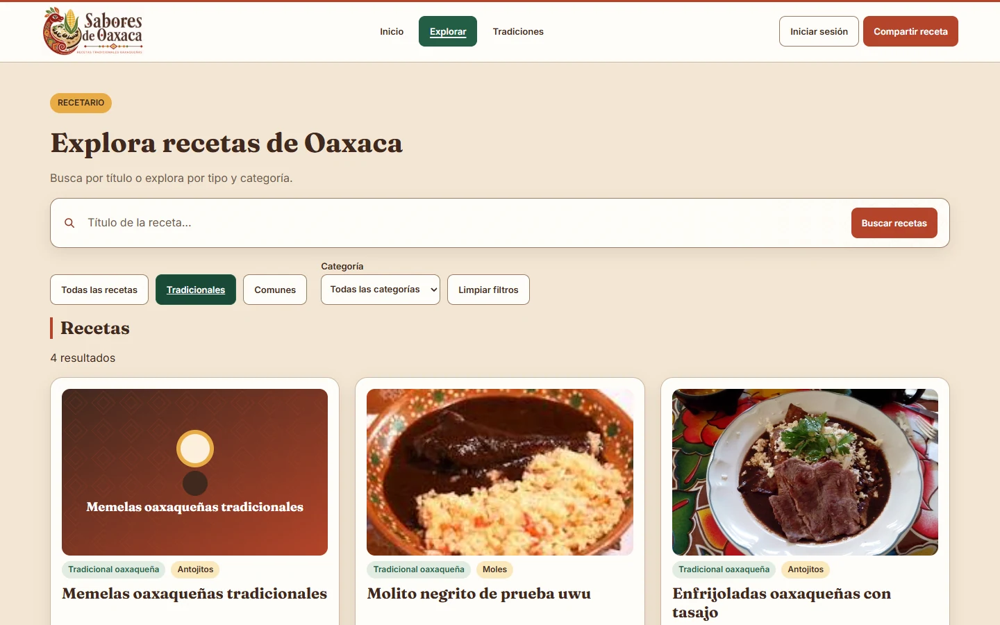

### Categoría

El selector de categoría muestra solo recetas de **Antojitos** en este ejemplo.

### Paginación

El catálogo mostraba **14 recetas en 3 páginas**. Se comprobó que **Siguiente** abre un grupo distinto de fichas y **Anterior** vuelve a la primera página.

## Detalle de receta

La [ficha de enfrijoladas](capturas/receta/ficha-de-enfrijoladas.webp) muestra la fotografía publicada, su descripción y la atribución a la cuenta de prueba autora.

La receta indica las cantidades para **4 personas** y presenta la preparación como una secuencia de pasos.

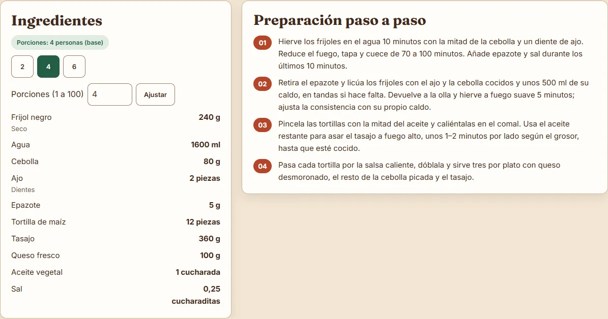

Al cambiar a **2 personas**, las cantidades se recalculan. Volver a **4 personas** restaura los valores originales.

## Tradiciones

La [presentación de Tradiciones](capturas/tradiciones/presentacion-gastronomica.webp) introduce la gastronomía de Oaxaca. La galería reúne las ocho regiones: Cañada, Costa, Istmo, Mixteca, Papaloapan, Sierra Norte, Sierra Sur y Valles Centrales. Cada tarjeta incluye una fotografía, su crédito y una descripción.

## Autenticación

**Inicio de sesión.** El formulario vacío muestra el acceso con correo y contraseña, y los enlaces de registro y recuperación.

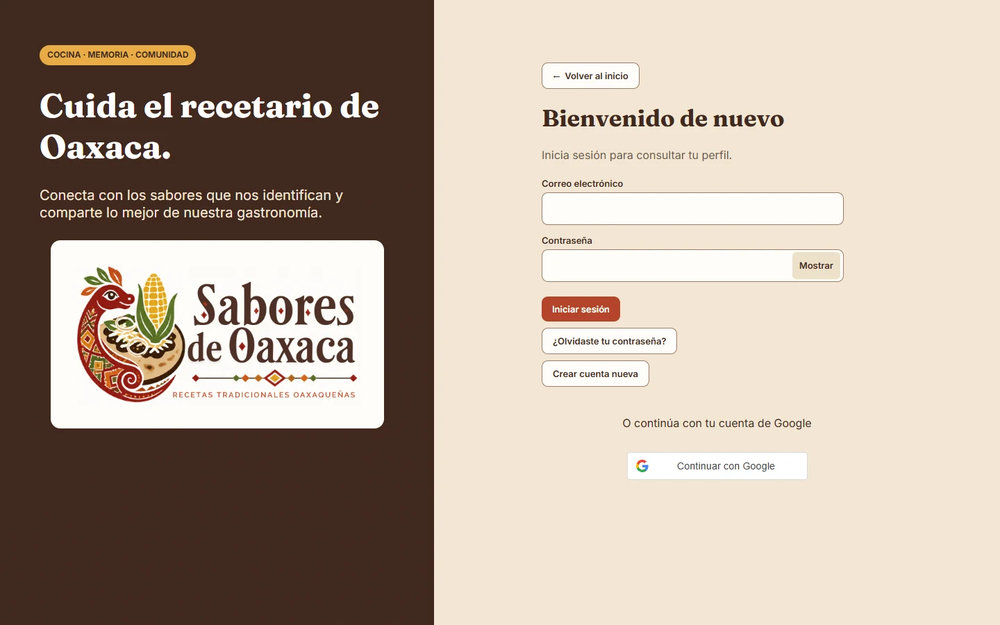

**Registro.** El formulario solicita nombre visible, correo, contraseña y confirmación.

**Recuperación de contraseña.** Se comprobó el formulario. No se solicitó ni se verificó la entrega de un correo.

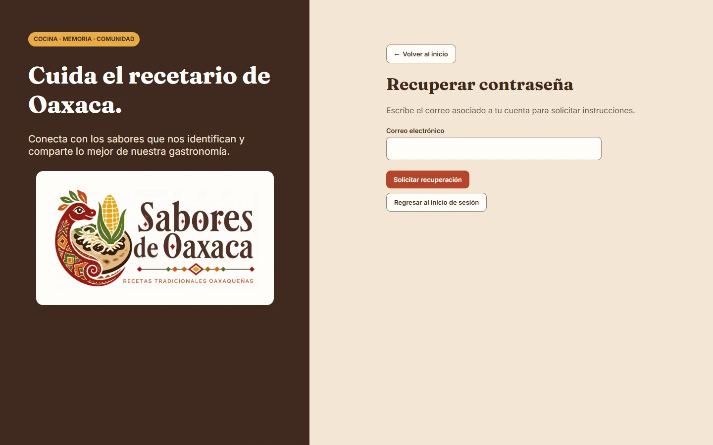

## Áreas autenticadas

### Usuario registrado

**Favoritos con sesión iniciada.** Tras iniciar sesión manualmente con la cuenta de prueba, se guardaron las enfrijoladas. El botón cambió a **Quitar de favoritos** y la receta apareció en **Mis recetas favoritas**. Al terminar se retiró el favorito temporal y se comprobó que el listado volvió a su estado inicial.

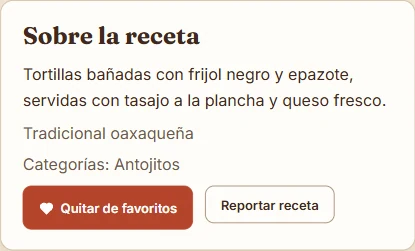

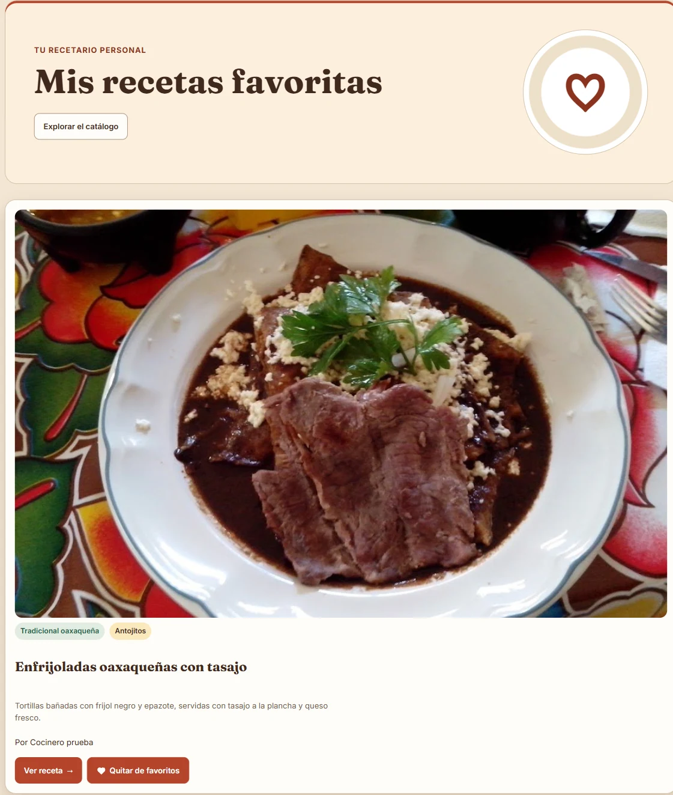

**Reportar una receta.** En una ficha de otra autoría, el formulario pide un motivo y permite revisar el envío. La vista previa ofrece confirmar, volver a editar o cancelar. Se canceló el borrador después de capturar la vista previa: no se envió ningún reporte.

| Formulario | Confirmación previa |
| :---: | :---: |
| 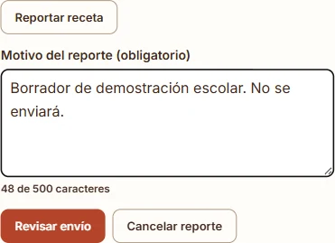 | 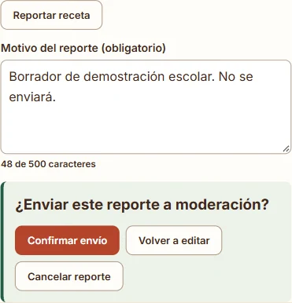 |

### Cocinero

**Mis recetas.** La cuenta de prueba muestra el listado propio, los totales por estado editorial y los controles de búsqueda y filtro. En la página consultada, las recetas visibles estaban publicadas.

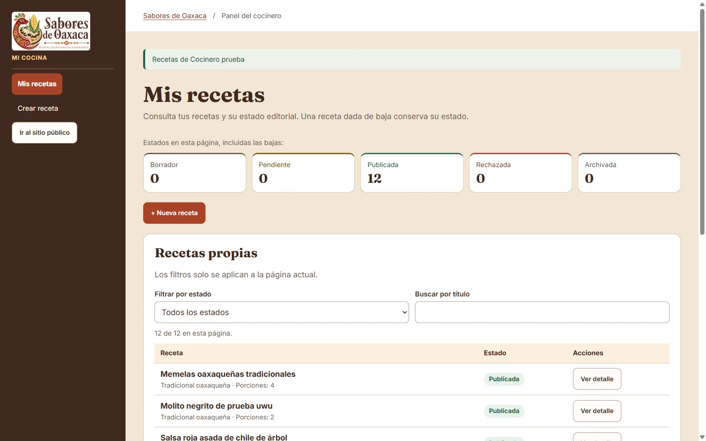

**Crear receta.** En el editor se seleccionó una categoría y se añadió un ingrediente del catálogo con su cantidad. Estos cambios quedaron en el formulario, sin guardar.

**Multimedia.** El selector admite fotos y videos en los formatos y tamaños indicados. No se subieron archivos.

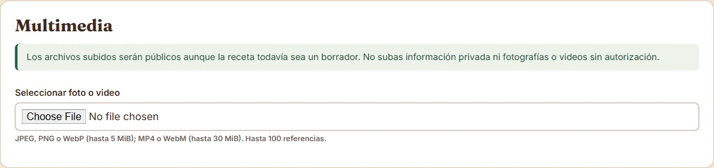

**Envío a revisión.** El formulario indica que primero hay que guardar un borrador. No había un borrador ni una receta rechazada editable en la página consultada, así que la evidencia llega hasta este requisito.

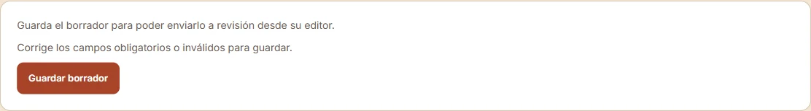

### Moderador

**Cola de recetas.** El panel muestra el número de pendientes y el filtro por tipo. En el momento de la consulta había **0 recetas pendientes**.

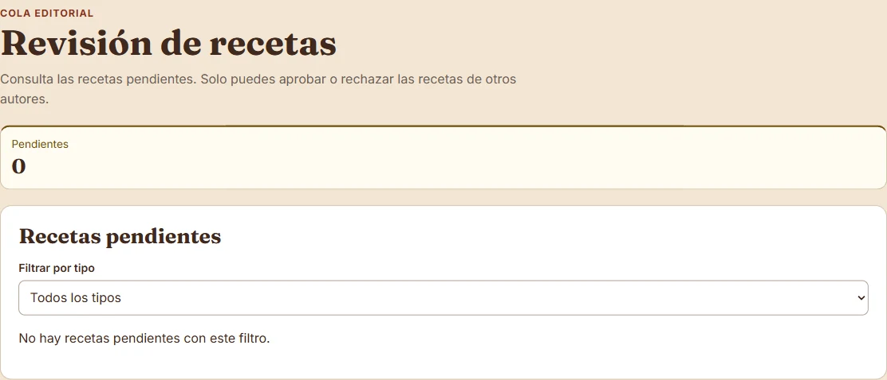

**Reportes.** Se consultó la bandeja y se aplicó el filtro **En revisión**, que devolvió una lista vacía. La captura muestra ese resultado sin exponer nombres ni motivos de los reportes.

## Diseño responsivo

En móvil, el contenido se apila para adaptarse al ancho de pantalla. Compárese con el [inicio de escritorio](capturas/inicio/presentacion-y-navegacion.webp), el [catálogo](capturas/explorar/catalogo-centrado.webp) y la [ficha](capturas/receta/ficha-de-enfrijoladas.webp).

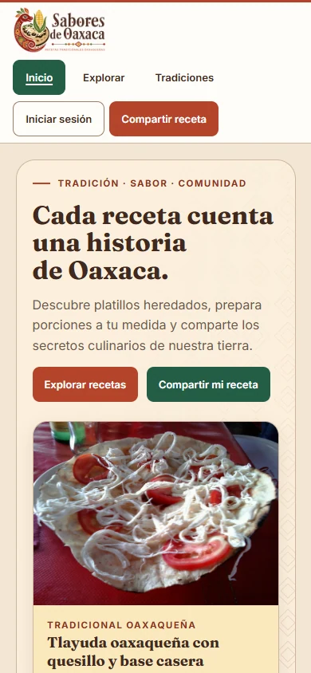

| Catálogo | Detalle de receta |
| :---: | :---: |
|  |  |

**Vista autenticada.** En móvil, la [lista de favoritos de escritorio](capturas/usuario/listado-de-favoritos.webp) ajusta la tarjeta al ancho disponible y mantiene los accesos para abrir o quitar la receta guardada.

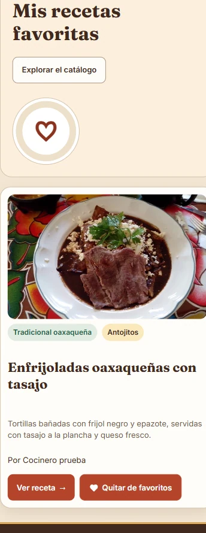

## Evidencia pendiente

| Funcionalidad | Estado de la evidencia |
| --- | --- |
| Reproducción de video | Ninguna de las 14 fichas publicadas consultadas contenía un video. |
| Entrega de correo de recuperación | Se comprobó la presencia del formulario. No se solicitó un mensaje. |
| Acción de enviar a revisión | Sin un borrador o una receta rechazada editable en la página consultada. No se creó ni envió una receta. |
| Detalle y opciones de aprobación y rechazo | La cola de moderación estaba vacía. No se tomaron decisiones sobre recetas. |
| Reportes con registros visibles | Se comprobó la bandeja y un filtro sin coincidencias. Se omitieron de la evidencia las filas con datos de reportantes. |
